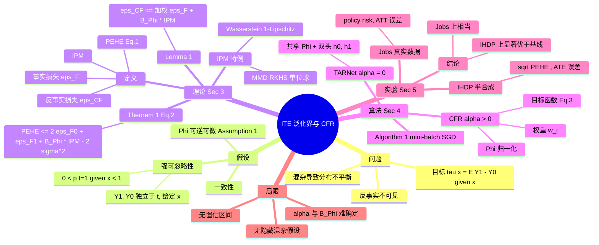
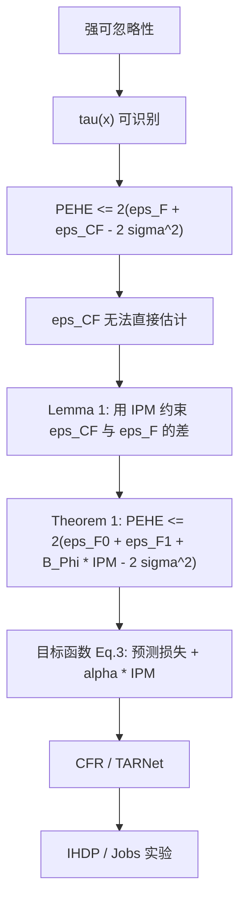

# 论文结构脑图

## Mindmap

## 论证链

## 符号表

| 符号 | 含义 | 位置 |
|---|---|---|
| Y₀, Y₁ | 潜在结果 | Sec 1 |
| τ(x) | ITE = m₁(x) − m₀(x) | Sec 1 |
| Φ, Ψ | 表示函数及其逆 | Assumption 1 |
| h | 表示空间上的假设 | Sec 3.1 |
| ε_F, ε_CF | 事实 / 反事实损失 | Def 2 |
| u | p(t=1) | Def 3 |
| PEHE | ITE 的均方误差 | Def 6 / Eq.1 |
| IPM_G | 积分概率度量 | Sec 3.1 |
| B_Φ | 使 ℓ/B_Φ ∈ G 的常数 | Lemma 1 |
| α, λ | IPM / 复杂度惩罚权重 | Eq.3 |
